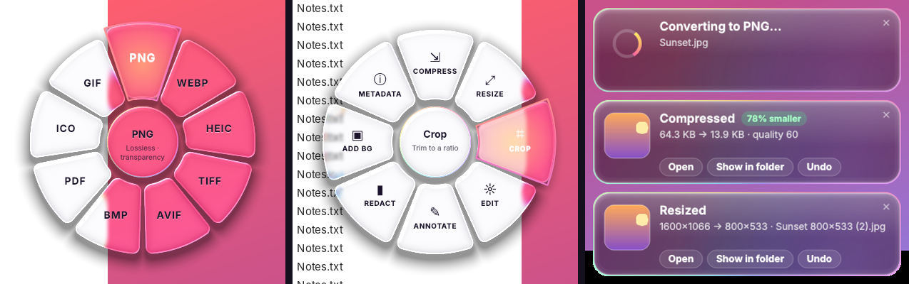

# DragShift (+ Video, Audio, 3D & mehr)

Fork von [DragShift](https://github.com/llamaboi55/DragShift) (MIT) mit Video-, Audio-, RAW-, 3D/CAD- und Adobe-Konvertierung, Verlauf, Drop-Icon, Ordner-Konvertierung und In-App-Updates. Datei ziehen → **Shift** → auf ein Segment fallen lassen.

**Download (Windows):** [neuestes Release](../../releases/latest) → **DragShift-Setup.exe** (empfohlen) oder die portable **DragShift.exe**. SmartScreen warnt, weil die App nicht signiert ist: *Weitere Informationen → Trotzdem ausführen*. FFmpeg und OpenSCAD sind enthalten.

## Was diese Version kann

| Dateien | Umwandeln in | Werkzeuge |
| --- | --- | --- |
| **Video** – MOV/QuickTime, MP4, MKV, MXF, AVI, MTS, WebM, ProRes RAW … | MP4 (H.264), H.265, ProRes 422/HQ, MOV/MKV (ohne Neukodierung), WebM, GIF, MP3/WAV | **Screenshots** (Player, framegenau) · Compress · **Fit size** (8/16/25 MB oder frei, Zwei-Pass) · 1080p · 720p · Rotate · Mute · Thumbnail |
| **Audio** – MP3, WAV, FLAC, M4A, ALAC, OGG, Opus, AIFF, WMA … | MP3 320k, WAV, FLAC, M4A, ALAC, OGG, Opus, AIFF (24 Bit bleibt 24 Bit, Cover & Tags bleiben) | Normalize (−14 LUFS) · Trim silence · Mono |
| **Bilder** – JPG, PNG, HEIC, WebP, AVIF, TIFF, PSD, **Kamera-RAW** (CR2/CR3, NEF, ARW, DNG, RAF …) | JPG, PNG, WebP, HEIC, AVIF, TIFF, PDF … (Kamera, Datum, GPS bleiben) | Compress (Qualität oder **Zielgröße frei in KB**) · Resize (auch 150 %/200 %) · Crop · Edit · Annotate · Redact · Add BG · Metadata |
| **3D** – STL, 3MF, OBJ, PLY, GLB, **STEP**, **OpenSCAD** | STL, 3MF, OBJ, PLY, GLB, PNG-Vorschau | Repair · Simplify · Center (auf Druckbett) |
| **CAD-Zeichnung** – DXF | PDF, PNG, SVG | – |
| **Adobe** – Premiere .prproj, Illustrator .ai | Premiere: Kopie für ältere Premiere-Versionen · AI: PDF, PNG, JPG, SVG | – |
| PDF, Word, Text | wie im Original | wie im Original |

**Neu in 1.6: ein Player für alles, Trimmen, Startkreis.**
- **Ein Fenster statt vieler:** Ordner oder mehrere Dateien öffnen → links eine Liste mit Vorschaubild, Länge und Auflösung, per Klick wechseln. Neue Videos, Audiodateien oder ganze Ordner einfach ins offene Fenster ziehen (oder ＋ / 📁). Öffnest du später weitere Dateien, landen sie im selben Fenster.
- **Trimmen** (Video und Audio): In mit **I**, Out mit **O** oder die gelben Griffe auf der Zeitleiste ziehen, **▶ In→Out** (P) spielt nur den Bereich, **🔁 Loop** (L) wiederholt ihn. **✂ Save trim**: „Exact“ schneidet framegenau (mit Grading, im Export-Format) oder „Fast“ ohne Neukodierung (sofort, ab Keyframe). Audio (WAV, MP3, FLAC …) wird sample-genau im gleichen Format geschnitten – mit Wellenform-Ansicht.
- **Werte eintippen:** Auf die Zahl neben Exposure, Contrast usw. klicken und tippen (auch „0,7“), Enter.
- **Klick aufs Drop-Icon** öffnet den Startkreis: Player, Trim, Convert, Folder, History, Settings. Dateien hineinziehen funktioniert wie bisher.
- Ordner im Kreismenü bietet jetzt zusätzlich **Player** und **Trim**; Video- und Audio-Tools haben **Trim**.

**Neu in 1.5: Player mit Ton, LUTs und Farbkorrektur.**
- Abspielen jetzt flüssig und **mit Ton** (bis 2×, darüber stumm), 🔊/🔇 mit M.
- **🎨 Color** (Taste C): Kamera-Profil (Sony S-Log3 · S-Gamut3.Cine/S-Gamut3, Fujifilm F-Log/F-Log2, Standard), **LUT** per Drag & Drop einer .cube-Datei oder aus „zuletzt benutzt“, eingebaute Kamera → Rec.709-Umwandlung, LUT-Stärke, Belichtung (echte Blenden), Kontrast, Lichter, Tiefen, Sättigung, Temperatur, Tönung. „Hold: original“ zeigt den Vorher-Zustand.
- **Presets**: LUT + alle Regler speichern und auf jedes Video anwenden, danach z. B. nur noch die Belichtung nachziehen.
- Screenshots kommen **mit Grading** in voller Auflösung (16-Bit-Verarbeitung); **Export** als H.264, H.265 10-Bit oder ProRes 422 HQ. Mehrere Videos auf einmal öffnen → mit ◀ ▶ (Bild↑/Bild↓) durchblättern, jedes behält seine Einstellungen, „Export all“ exportiert alle.
- **Kreismenü:** Die Kategorie (Convert ⇄ Tools) wechselt nur noch mit dem **Mausrad** – Hovern ändert nichts mehr.
- **Tray-Symbol:** Einfacher Klick macht nichts mehr, **Doppelklick holt den Drop-Kreis nach unten rechts** (und schaltet ihn ein, falls er aus war).

**Neu in 1.4: Screenshots aus Videos.** Video ziehen → Shift → *Tools → Screenshots*. Ein kleiner Player öffnet sich: Slider ziehen, ←/→ Bild für Bild, Shift+←/→ eine Sekunde, ±10 s, Abspielen mit 1×–16× (Leertaste), dann **Screenshot** (S oder Enter). Gespeichert wird der exakte Frame in voller Auflösung als PNG oder JPG neben dem Video („Clip 01m23.456s.png“); HDR-Videos (iPhone) werden für das Bild in normale Farben umgerechnet.

**Neu in 1.3**
- **Drop-Icon:** schwebender Knopf (an/aus im Tray-Menü und in den Einstellungen). Dateien oder Ordner hineinziehen → das Menü öffnet sich direkt daneben. Mit der Maus verschiebbar, Rechtsklick für Verlauf/Einstellungen/Ausblenden.
- **Verlauf:** Tray → *History…* – Öffnen, Ordner zeigen, ✕ pro Eintrag, *Clear all* (die Dateien selbst bleiben).
- **Ordner konvertieren:** Ordner aufs Icon ziehen, Rechtsklick auf einen Ordner → *Convert with DragShift…*, oder Shift-Drag. Pro Dateityp ist ein Ziel vorausgewählt (HEIC → JPG, MOV → MP4, WAV → MP3 …), Unterordner optional, Ergebnis in „Ordner (converted)“ mit gleicher Struktur.
- **Updates im Programm:** einmal täglich oder Tray → *Check for updates…*: lädt das neue Setup und installiert es still, DragShift startet danach neu. Setzt voraus, dass dieses GitHub-Repo öffentlich ist.

Kamera-RAW-**Video** von Blackmagic (BRAW), RED (R3D), ARRI und Canon Cinema RAW lässt sich nur mit den SDKs der Hersteller lesen – DragShift sagt das und verweist auf DaVinci Resolve. Premiere-Projekte aus älteren Versionen öffnet die neue Premiere selbst; das Werkzeug hier ist für die andere Richtung (neu → alt).

**Aus dem Quellcode starten (Python 3.12):** `pip install -r requirements.txt` und `python -m dragshift`.

---

## Lizenzen

DragShift basiert auf [DragShift von llamaboi55](https://github.com/llamaboi55/DragShift) (MIT-Lizenz, siehe `LICENSE`). Der Windows-Installer enthält zusätzlich unveränderte Programme anderer Projekte:
- **FFmpeg** (GPL-Build von [BtbN/FFmpeg-Builds](https://github.com/BtbN/FFmpeg-Builds), Lizenztext im Programmordner unter `ffmpeg/FFMPEG-LICENSE.txt`; Quellcode: [ffmpeg.org](https://ffmpeg.org/download.html#get-sources) und [BtbN/FFmpeg-Builds](https://github.com/BtbN/FFmpeg-Builds))
- **OpenSCAD** 2021.01 (GPL-2.0; Quellcode: [github.com/openscad/openscad](https://github.com/openscad/openscad/tree/openscad-2021.01))
- Python-Bibliotheken wie PySide6 (LGPL), Pillow, PyMuPDF (AGPL), trimesh, ezdxf, rawpy (LibRaw), sounddevice (PortAudio) – jeweils unter ihren eigenen Lizenzen.

## Original-README (upstream)


Convert and edit files on **Windows, Mac and Linux** with a liquid-glass radial menu. Start dragging any file, press **Shift**, and drop it on a slice.



## Download

From the [latest release](../../releases/latest):

- **DragShift-Setup.exe** (recommended): installs for your user only, so no admin rights are needed. It adds a Start menu entry, an option to start with Windows, a right-click **DragShift…** entry and a **Send to → DragShift** entry. It uninstalls cleanly from Settings → Apps.
- **DragShift.exe**: a portable version you can run from anywhere.

**Mac (easiest, no security warning):** paste this into Terminal:

```bash
curl -fsSL https://raw.githubusercontent.com/llamaboi55/DragShift/main/install-mac.sh | bash
```

It picks the right build for your Mac, installs it to Applications and opens it ([see what it does](install-mac.sh)). Run the same line again to update.

Or download the .dmg yourself:
- **DragShift-mac-apple-silicon.dmg**: for Macs with M1, M2, M3 or M4 chips (macOS 11 or later).
- **DragShift-mac-intel.dmg**: for Intel Macs.

Open the .dmg and drag **DragShift** into Applications. DragShift lives in the menu bar and has no Dock icon. You can also right-click any file → **Open With → DragShift**.

**Linux (Debian, Ubuntu, Mint, MX… with XFCE, MATE, Cinnamon or any X11 desktop):** download **DragShift-linux-amd64.deb**, then run:

```bash
sudo apt install ./DragShift-linux-amd64.deb
```

Open **DragShift** from the app menu. It sits in the panel's notification area, and you can turn on *Start at login* in Settings. It works in Thunar, Nautilus, Nemo, Caja, Dolphin and on the desktop, and it also adds **Open With → DragShift** to file right-click menus. It works with or without a compositor: when compositing is off (common on XFCE), the menu and windows are cut to their exact shape, so you won't see black boxes. Builds target Debian 12 or newer (Ubuntu 23.04+).

> **Wayland:** Wayland doesn't let apps read the global Shift and mouse state, so the Shift + drag trigger only works in X11 sessions (XFCE is X11). On GNOME/KDE Wayland, use right-click → **Open With → DragShift**, or pick *"Ubuntu on Xorg"* / *"Plasma (X11)"* at the login screen.

> **First launch on Windows:** SmartScreen may warn because the app isn't code-signed yet. Click **More info → Run anyway**.
>
> **First launch on Mac, if you used the .dmg instead of the Terminal line:** macOS says *"Apple could not verify 'DragShift' is free of malware."* This happens with any app that hasn't paid for Apple's notarization; DragShift's code is all public in this repo. To open it:
> 1. Open DragShift once and click **Done** on the warning.
> 2. Go to  → **System Settings → Privacy & Security**, scroll down to *"DragShift was blocked…"* and click **Open Anyway**. Enter your password and confirm.
> 3. That's it. macOS remembers the choice.
>
> Or, in Terminal: `xattr -dr com.apple.quarantine /Applications/DragShift.app`
> (On macOS 15 and later, the old right-click → Open shortcut no longer skips this warning.)
>
> **Mac, optional:** allow **Screen Recording** when DragShift asks, so the glass can refract the windows behind it. Without it, the glass shows your wallpaper. Nothing is ever saved or sent.

## How to use

1. Start dragging a file (an image, PDF, Word or text file; desktop shortcuts to one work too) in File Explorer, Finder, your Linux file manager or on the desktop.
2. Press **Shift**. The menu opens under your cursor.
3. Drop the file on a slice. The result is saved **next to the original**, and the original is never changed.
4. To switch between **Convert** and **Tools**, tap **Shift** again.

Each action ends with a notification that shows what changed, for example *"2.4 MB → 610 KB · 75% smaller"* or *"2400×1600 → 1200×800"*, with **Open**, **Show in folder** and **Undo**. Undo moves the new file to the Recycle Bin (Trash on Mac and Linux).

You can also right-click a file → **DragShift…**, use **Send to → DragShift**, or double-click the tray icon to pick a file.

## What it does

| File | Convert to | Tools |
|---|---|---|
| Images (JPG, PNG, WEBP, HEIC, AVIF, TIFF, BMP, GIF, ICO) | Any of those, or PDF. Several images become one combined PDF | **Compress** (by quality or to a target size such as "under 500 KB", with a before/after preview, several files at once) · **Resize** · **Crop** (ratios, live pixel size, rotate) · **Edit** (Auto, light/colour, rotate, flip, B&W, hold to compare) · **Annotate** (arrows, boxes, numbered steps, text, marker) · **Redact** · **Add BG** · **Metadata** (camera, date, GPS location with a map link; remove location only or remove everything) |
| PDF | JPG or PNG (one per page), DOCX, TXT | Compress · Split · Rotate · Merge (drop several) · **Protect** (AES-256 password) · **Extract images** · Metadata |
| Word (.docx) | PDF (uses Microsoft Word if it's installed, otherwise a built-in renderer), TXT | — |
| Text (.txt, .md, .csv…) | PDF, DOCX | — |

**Settings** (tray menu): trigger key (Shift, Ctrl or Alt), where results go (next to the original or a `DragShift` subfolder), JPG/WebP quality, PDF → image resolution, and start at login.

## The look

The menu, notifications and windows use real **liquid-glass** rendering. DragShift captures the screen behind each surface and refracts it through the shape. A curved edge bends light, R, G and B bend by slightly different amounts (which gives the rainbow fringe), a highlight runs along the rim facing the light, and the tint adapts to what's behind it so text stays readable. The menu renders on a background thread while it pops in, so it still opens instantly.

## Tested on real desktops

Every push runs these jobs on GitHub's Windows, Mac and Linux machines:

- **Build:** unit tests, the portable exe and installer builds, a self-test of each build, and a silent install → run → uninstall check.
- **End-to-end:** a script moves the real mouse to drag files from File Explorer *and* the Desktop, presses Shift, drops on every conversion and tool, drives each tool window, and checks every output file (format, dimensions, page counts, encryption, metadata removed). The results table and a screen recording are saved to the `e2e-output` branch.
- **Mac end-to-end:** real Finder drags with Shift (Quartz mouse and keyboard events) through conversions, PDF tools, merging and the tool windows. Every output is checked, and the run is recorded to the `e2e-mac-output` branch.
- **Mac builds:** `DragShift.app` and the .dmg for Apple Silicon and Intel, each self-tested inside the app bundle.
- **Debian/XFCE:** builds the .deb on Debian 12, installs it, and runs the same kind of end-to-end test in Thunar under XFCE's window manager with the compositor **off**. Real XTest drags with Shift go through conversions, PDF tools, merging, the tool windows and Open With. The results and a recording are saved to the `e2e-linux-output` branch.
- **Demo video:** pushing to the `demo` branch records a showcase video.

## Support

DragShift is free. If it saves you time, you can leave a tip on Cash App: [**$AtikaKadesha**](https://cash.app/$AtikaKadesha). Thank you!


## License

[MIT](LICENSE): free to use, modify and share.

## Run from source

```bash
pip install -r requirements.txt
python -m dragshift
```

On Linux, PySide6 also needs the Qt XCB libraries: `sudo apt install libxcb-cursor0 libxkbcommon-x11-0`.

Tests: `python -m pytest -q`. Logs are written to `%LOCALAPPDATA%\DragShift\log.txt` on Windows, `~/Library/Logs/DragShift/log.txt` on Mac and `~/.local/share/DragShift/log.txt` on Linux.

Windows builds will be code-signed by the SignPath Foundation, which provides free code signing for open-source projects.
